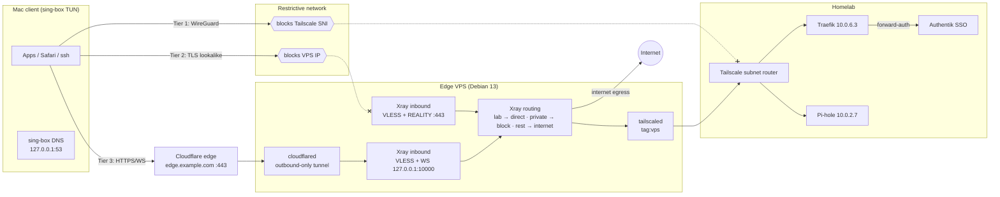
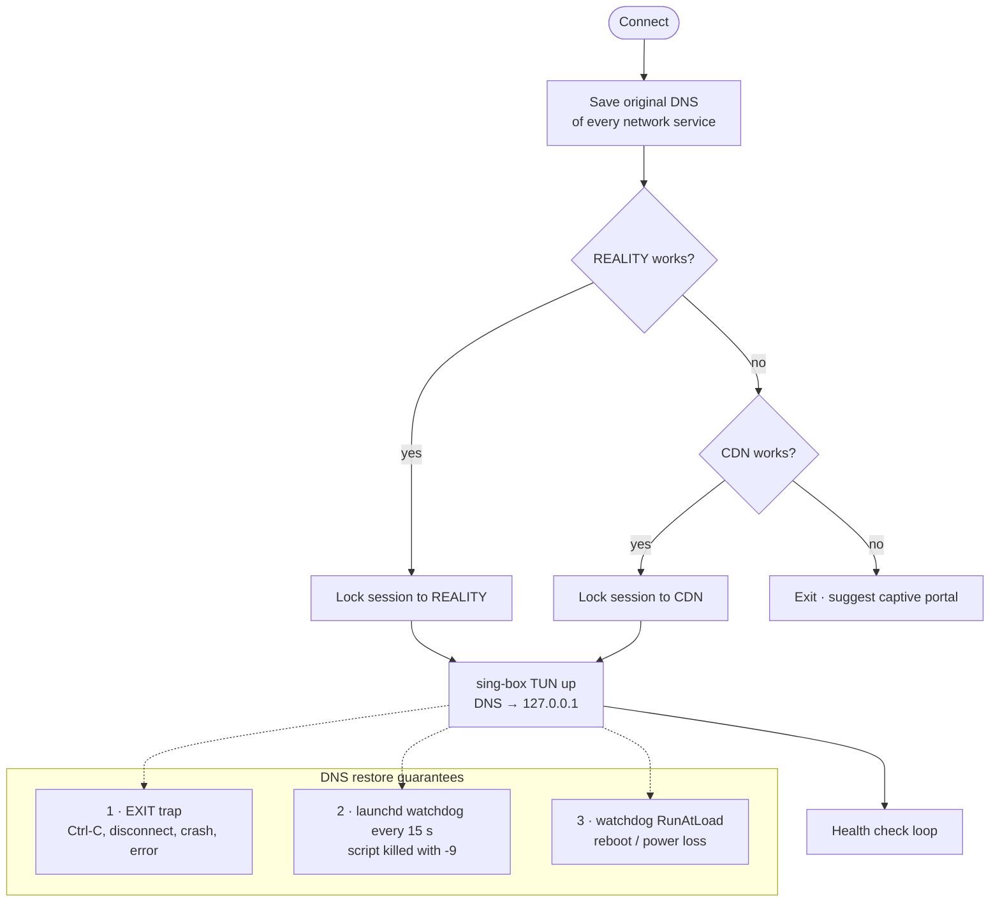

# SauerSec Edge

**A three-tier, censorship-resistant remote-access design for a self-hosted homelab — with least-privilege edge routing and fail-safe client DNS handling.**

Built and battle-tested in September 2026 against a real hostile network: a restrictive guest network that blocks Tailscale by SNI *and* drops connections to the relay VPS's IP address.

---

## The problem

Everyday remote access to the lab runs over Tailscale. That works on open networks, but restrictive networks (guest networks, corporate filters) increasingly block it — and a determined filter will also block any single VPS IP you fall back to.

The goal: **reach the lab — and optionally route all traffic — from any network that allows ordinary HTTPS**, without exposing the lab itself to the internet and without giving the edge box more reach than it needs.

## Architecture

Three tiers, each existing because a network might block the one above it:

| Tier | Path | Survives |
|---|---|---|
| 1 · Tailscale | Client → WireGuard mesh → lab | Open networks (everyday path) |
| 2 · REALITY | Client → VPS IP :443 (Xray VLESS + REALITY) → tailnet → lab | Tailscale blocked, VPS IP reachable |
| 3 · CDN | Client → Cloudflare edge → Cloudflare Tunnel → VPS → tailnet → lab | Tailscale **and** VPS IP blocked |



### Why each tier is built the way it is

- **REALITY cannot ride a CDN.** REALITY borrows a real site's TLS handshake end-to-end; Cloudflare terminates TLS at its edge, so the handshake never reaches the VPS. Tier 3 therefore uses a *second* Xray inbound (VLESS over WebSocket) on the same VPS.
- **Tier 3 uses a Cloudflare Tunnel, not an orange-cloud DNS record.** `cloudflared` dials out, so the WS inbound listens only on `127.0.0.1`, no new port is exposed, no origin certificate is needed, and the VPS IP never appears in DNS.
- **Both inbounds share one routing policy,** so the security posture can't drift between tiers.

## Security controls

| Control | Where | What it enforces |
|---|---|---|
| Loopback-only CDN inbound | Xray | WS inbound reachable only via the local `cloudflared` |
| Allow-then-deny routing | Xray | Lab + tailnet ranges → direct; **all RFC1918, loopback, link-local (incl. cloud metadata 169.254.169.254), ULA → blackhole**; everything else → internet |
| `IPIfNonMatch` domain strategy | Xray | Hostnames are resolved *before* rule matching, so a domain pointing at a private IP can't bypass the block rule |
| `sniffing.routeOnly` | Xray | Sniffed SNI is used for routing decisions only; the connection still goes to the requested IP (fixes split-horizon names) |
| Tagged node + scoped ACL | Tailscale | VPS joins as `tag:vps` with `--accept-dns=false`; ACL grants only the lab subnet and Pi-hole DNS |
| Access logging off | Xray | `loglevel: warning`, `access: none` — the edge doesn't keep a browsing history |
| Root-only client config | macOS | Credentials live in `/usr/local/etc/nyc-vpn/client.json` (0600 root); the root job can't be re-pointed by a user-writable file |
| Scoped sudoers | macOS | Password-free rights for exactly three commands (start, stop, restore DNS) |
| Credential rotation | Both | UUID rotated after accidental exposure in a screenshot |

## The client: fail-safe by design

The macOS client is a SwiftBar menu bar item driving a root LaunchDaemon. It:

1. **Probes REALITY first, then CDN**, with a real HTTP 204 check through each — and **locks the session to one path** (no mid-session flapping that drops SSH).
2. **Captures all traffic** via a sing-box TUN interface (IPv4 + IPv6, so nothing leaks around the tunnel).
3. **Split DNS:** lab names → Pi-hole *through the tunnel*; everything else → 1.1.1.1 *through the tunnel*; the tunnel's own server name → a DoH bootstrap resolver *outside* it (breaks the resolution loop).
4. **Health-checks every 20 s** (internet + lab DNS); the icon turns red if traffic stops flowing.
5. **Always restores DNS**, in three independent layers:



## Repository layout

```
docs/
  design-decisions.md    # ADR-style record of every non-obvious choice
  lessons-learned.md     # the debugging war stories, root causes, and fixes
  threat-model.md        # what this protects against, and what it doesn't
server/
  xray/config.example.json
  tailscale/acl-excerpt.hujson
  cloudflared.md
client/
  config/client.example.json   # sing-box client template
  macos/
    bin/nyc-vpn                # connect script (path selection, DNS, health)
    bin/nyc-vpn-restore        # DNS restore (also the watchdog entry point)
    launchd/*.plist            # job + watchdog
    sudoers/nyc-vpn            # least-privilege rule template
    swiftbar/nyc-vpn.5s.sh     # menu bar UI
    newsyslog/nyc-vpn.conf     # log rotation
    install.sh
```

All secrets, public IPs, and real hostnames are replaced with placeholders (`<UUID>`, `<VPS_IP>`, `example.com`, …).

## Stack

Xray-core 26.x · sing-box 1.12+ · Cloudflare Tunnel · Tailscale · Pi-hole v6 · Traefik · Authentik · Debian 13 · macOS (launchd, SwiftBar)

## Status

- [x] Tier 3 verified end-to-end on the target hostile network
- [x] Full-tunnel egress from the VPS; lab access by name through the tunnel
- [x] Menu bar client with health status, instant cancel/disconnect
- [ ] Tailscale-conflict guard verified live
- [ ] Pi-hole local record + Traefik route for the SSO host (removes the DNS exception)
- [ ] Migrate Tier 3 transport from WebSocket (deprecated in Xray) to XHTTP
